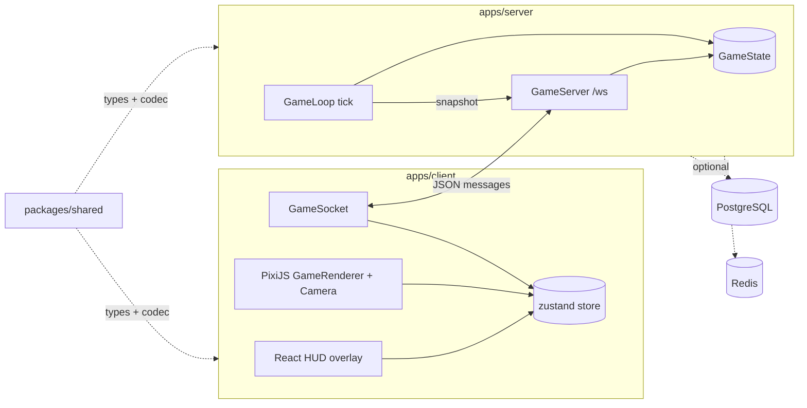

# Architecture

Browser-based 2D strategy game. An authoritative Node server runs the simulation and streams
state over one WebSocket; a React client renders it with PixiJS. Constraints: see
[`AGENTS.md` § Invariants](../AGENTS.md#invariants).



## Directory tree

```
apps/
  client/          React + Vite + PixiJS + Tailwind  → AGENTS_APP.md
  server/          Node + ws + Drizzle + ioredis     → AGENTS_SERVER.md
packages/
  shared/src/      map.ts, entities.ts, messages.ts (types + JSON codec)
tsconfig.json      base compiler options; workspaces extend it
eslint.config.js   flat config for all workspaces
docker-compose.yml local Postgres 17 + Redis 7
```

## Shared package

`@vectoria/shared` ships TypeScript source (`exports` → `src/index.ts`). Vite and `tsx` consume
it directly; `tsup` bundles it into the server build (`noExternal`). It has no runtime deps and
must stay free of DOM and Node APIs.

## Network protocol

One WebSocket at `/ws`, JSON text frames, `{ type, ... }` discriminated unions in
`packages/shared/src/messages.ts`. Bump `PROTOCOL_VERSION` on breaking changes.

| Direction | Type | Purpose |
| --------- | ---- | ------- |
| C→S | `ping` | RTT probe; echoed as `pong` |
| C→S | `selectTile` | Player selects a tile; server bounds-checks |
| S→C | `welcome` | On connect: `playerId`, `tickRate`, full `MapData` |
| S→C | `snapshot` | Every tick: `tick` + all `EntityState`s |
| S→C | `error` | `bad_message` / `invalid_tile` / `rate_limited` |

Server validates every client message with `parseClientMessage`; add a case there for each new
client message type.

## Where should I change X?

| Change | Go to |
| ------ | ----- |
| Message shape, tile/entity types | `packages/shared/src/` (then both apps) |
| Simulation, tick, connections, DB/Redis | [AGENTS_SERVER.md](./AGENTS_SERVER.md) |
| Rendering, camera, HUD, client networking | [AGENTS_APP.md](./AGENTS_APP.md) |
