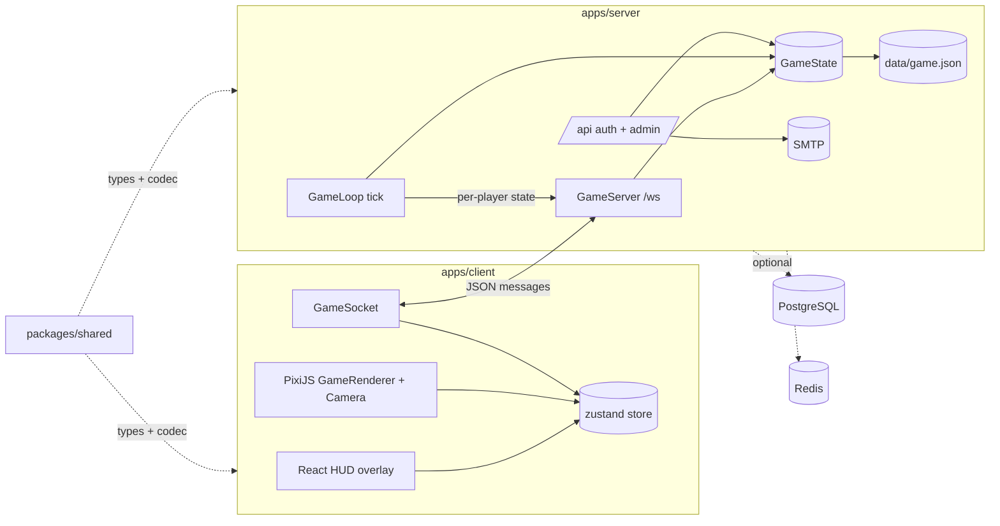

# Architecture

Browser-based 2D strategy game. An authoritative Node server runs the simulation and streams
state over one WebSocket; a React client renders it with PixiJS. Constraints: see
[`AGENTS.md` § Invariants](../AGENTS.md#invariants).



## Directory tree

```
apps/
  client/          React + Vite + PixiJS + Tailwind + shadcn/ui  → AGENTS_APP.md
  server/          Node + ws + Drizzle + ioredis     → AGENTS_SERVER.md
packages/
  shared/src/      map.ts, entities.ts, rules.ts, messages.ts, pathfinding.ts, duo.ts, stats.ts,
                   calendar.ts (types, balance, JSON codec, land routes + raid planning, duo
                   plans, per-player stats for the admin panel, gameday hours)
tsconfig.json      base compiler options; workspaces extend it
eslint.config.js   flat config for all workspaces
docker-compose.yml local Postgres 17 + Redis 7
Dockerfile         production image (server + client)     → DEPLOYMENT.md
deploy/            server-side compose, deploy.sh, env template
.github/workflows/ ci.yml (PRs), deploy.yml (main → GHCR → VPS)
```

## Shared package

`@vectoria/shared` ships TypeScript source (`exports` → `src/index.ts`). Vite and `tsx` consume
it directly; `tsup` bundles it into the server build (`noExternal`). It has no runtime deps and
must stay free of DOM and Node APIs.

## Network protocol

One WebSocket at `/ws?token=…`, JSON text frames, `{ type, ... }` discriminated unions in
`packages/shared/src/messages.ts`. Bump `PROTOCOL_VERSION` on breaking changes. Unknown token →
close code `4001` (client drops its token and shows the join screen).

| Direction | Type | Purpose |
| --------- | ---- | ------- |
| C→S | `ping` | RTT probe; echoed as `pong` |
| C→S | `setActivity` | Base activity for the next gameday |
| C→S | `buy` | Troop batches (queued, ready after `TROOP_PRODUCTION_MS`) or victory points (at most `VICTORY_POINTS_PER_GAMEDAY` per gameday); refused while `SelfState.upkeepDebt` cannot be paid on top |
| C→S | `sendArmy` | From a base (`from`: outpost id / null = home), troops, target (`castle`/`outpost`/`spot`/`chest`/`army` = raid), `useActiveCard`, `cargo` (stone only, to the trader, with `trade` {gold, wood}; anything else is refused) |
| C→S | `redirectArmy` | New target for an army in the field |
| C→S | `recallArmy` | Recall an army |
| C→S | `activateCard` | Instant card: takes effect (with `target`: own outpost id, player id or foreign army id, for cards that aim); march card: armed for the next army; `null` disarms |
| C→S | `openChest` | Open a chest brought home; answered with `chestOpened` |
| C→S | `duoOffer` | Duo attack offer: `partnerId`, `target` (enemy castle/outpost), own `sources` (`{from, troops}[]`), `partnerTroops` |
| C→S | `duoAnswer` | Partner accepts (with own `sources` summing to the asked troops) or declines |
| C→S | `duoWithdraw` | Initiator takes back an unanswered offer |
| C→S | `duoAbort` | Ask to call a running duo off, agree to the other's request, or take the own request back |
| C→S | `visibility` | Page in view or not; while one of a player's pages is in view, no push goes out |
| C→S | `pushSubscribe` / `pushUnsubscribe` | Web Push on/off for this device (`PushSubscriptionData` + chosen `topics` from `PUSH_TOPICS`: `returned`, `outpost`, `attack`, `raid`; endpoint only https on known push services, `isPushEndpoint`) |
| S→C | `welcome` | On connect: `playerId`, `tickRate`, `MapData` (null before start), `pushKey` (VAPID public key) |
| S→C | `map` | Map changed (game start / reset) |
| S→C | `state` | Every tick: this player's filtered `GameView` |
| S→C | `chestOpened` | The card from the chest just opened (drives the reveal animation) |
| S→C | `error` | `bad_message` / `rate_limited` / `rejected` (rule violation, shown as toast) |

HTTP (same port): `POST /api/auth/start` (email [+ name] → code by mail, or `needsName`),
`POST /api/auth/verify` (email + code → token), `GET /api/lobby`, `GET /api/admin/state` (incl.
per-player `stats`: online time, attacks started/executed/won …, and `world`: castles, spots,
outposts, chests for the map editor), `GET /api/admin/map` (the tiles),
`POST /api/admin/action` (bearer `ADMIN_TOKEN`; incl. `place` / `move` / `remove` of chests,
outposts and spots on free mainland tiles — armies heading for a moved piece re-route), `GET /healthz`, `GET /source` (redirect to the
repository; the client links it on the join screen and in the handbook to satisfy AGPL-3.0 §13).

Web Push (outside the socket): the server posts a `PushNotice` (`topic`, `title`, `body`, `tag`)
to each subscribed device of a player that chose its topic, for events that call them back — troops usable again (home, at an
own outpost, an outpost taken) and open attacks on them (castle, outpost, a hunted army; not
stealth marches, not duo groups before they unite). Arrivals at deposits send nothing. The
service worker (`apps/client/public/sw.js`) shows it; same `tag` replaces.

`pathfinding.ts` is shared so the client previews routes, travel times and raid meeting points
with exactly the server's maths; `calendar.ts` (gameday hours, break days) likewise, so the client
turns game-clock spans into real arrival times (`realTimeAfter`).

Server validates every client message with `parseClientMessage` and admin bodies with
`parseAdminAction`; add a case there for each new type. Game rules: [AGENTS_GAME.md](./AGENTS_GAME.md).

## Where should I change X?

| Change | Go to |
| ------ | ----- |
| Message shape, tile/entity types | `packages/shared/src/` (then both apps) |
| Balance numbers, cards | `packages/shared/src/rules.ts` → [AGENTS_GAME.md](./AGENTS_GAME.md) |
| Simulation, tick, connections, DB/Redis | [AGENTS_SERVER.md](./AGENTS_SERVER.md) |
| Rendering, camera, HUD, client networking | [AGENTS_APP.md](./AGENTS_APP.md) |
