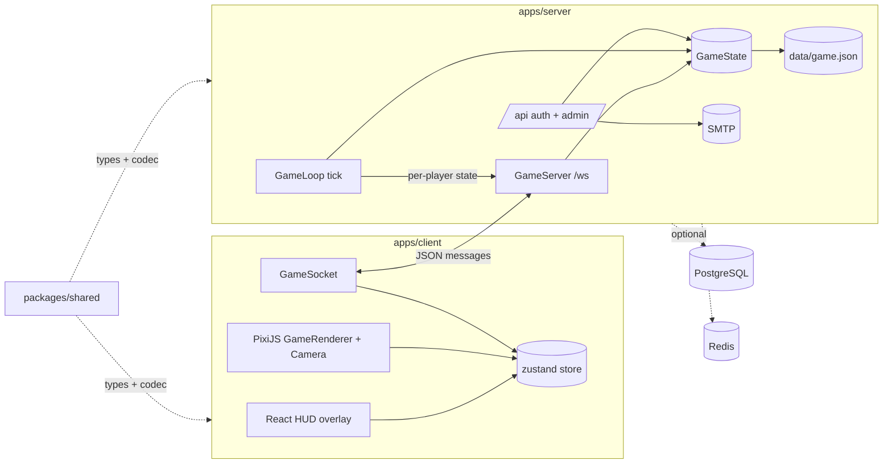

# Architecture

Browser-based 2D strategy game. An authoritative Node server runs the simulation and streams
state over one WebSocket; a React client renders it with PixiJS. Constraints: see
[`AGENTS.md` § Invariants](../AGENTS.md#invariants).



## Directory tree

```
apps/
  client/          React + Vite + PixiJS + Tailwind  → AGENTS_APP.md
  server/          Node + ws + Drizzle + ioredis     → AGENTS_SERVER.md
packages/
  shared/src/      map.ts, entities.ts, rules.ts, messages.ts, pathfinding.ts
                   (types, balance, JSON codec, land routes + raid planning)
tsconfig.json      base compiler options; workspaces extend it
eslint.config.js   flat config for all workspaces
docker-compose.yml local Postgres 17 + Redis 7
```

## Shared package

`@vectoria/shared` ships TypeScript source (`exports` → `src/index.ts`). Vite and `tsx` consume
it directly; `tsup` bundles it into the server build (`noExternal`). It has no runtime deps and
must stay free of DOM and Node APIs.

## Network protocol

One WebSocket at `/ws?token=…`, JSON text frames, `{ type, ... }` discriminated unions in
`packages/shared/src/messages.ts`. Bump `PROTOCOL_VERSION` on breaking changes. Unknown token →
close code `4001` (client drops its token and shows the join screen).

| Direction | Type | Purpose |
| --------- | ---- | ------- |
| C→S | `ping` | RTT probe; echoed as `pong` |
| C→S | `setActivity` | Base activity for the next gameday |
| C→S | `buy` | Troop batches or victory points |
| C→S | `sendArmy` | From a base (`from`: outpost id / null = home), troops, target (`castle`/`outpost`/`spot`/`chest`/`army` = raid), march cards, `cargo` |
| C→S | `redirectArmy` | New target for an army in the field |
| C→S | `recallArmy` / `playCard` | Recall an army / play an instant card |
| S→C | `welcome` | On connect: `playerId`, `tickRate`, `MapData` (null before start) |
| S→C | `map` | Map changed (game start / reset) |
| S→C | `state` | Every tick: this player's filtered `GameView` |
| S→C | `error` | `bad_message` / `rate_limited` / `rejected` (rule violation, shown as toast) |

HTTP (same port): `POST /api/auth/start` (email [+ name] → code by mail, or `needsName`),
`POST /api/auth/verify` (email + code → token), `GET /api/lobby`, `GET /api/admin/state`,
`POST /api/admin/action` (bearer `ADMIN_TOKEN`), `GET /healthz`.

`pathfinding.ts` is shared so the client previews routes, travel times and raid meeting points
with exactly the server's maths.

Server validates every client message with `parseClientMessage` and admin bodies with
`parseAdminAction`; add a case there for each new type. Game rules: [AGENTS_GAME.md](./AGENTS_GAME.md).

## Where should I change X?

| Change | Go to |
| ------ | ----- |
| Message shape, tile/entity types | `packages/shared/src/` (then both apps) |
| Balance numbers, cards | `packages/shared/src/rules.ts` → [AGENTS_GAME.md](./AGENTS_GAME.md) |
| Simulation, tick, connections, DB/Redis | [AGENTS_SERVER.md](./AGENTS_SERVER.md) |
| Rendering, camera, HUD, client networking | [AGENTS_APP.md](./AGENTS_APP.md) |
